# Flywheel Architecture & Tech-Stack

This document is automatically generated by `gen_architecture.py`. It describes the layout, components, and communication pathways of the **flywheel** framework instance.

## Tech-Stack Overview
- **Core Orchestrator**: 6-tier agentic wrapper supporting Claude Code, Codex, OpenCode, Google Antigravity, and Shared.
- **Automation Engine**: POSIX Bash + Python 3 + Node.js utility scripts.
- **State Store**: 5 flat JSON ledger files (schema-validated).
- **Dashboard**: single-page web dashboard, template-driven.

## Component Architecture

```mermaid
flowchart TD
    coord["Coordinator<br>(Main Session)"]
    architect["Architect Tier<br>(architect)"]
    strategist["Strategist Tier<br>(researcher)"]
    engineer["Engineer Tier<br>(engineer)"]
    utility["Utility Tier<br>(utility)"]
    verifier["Verifier Tier<br>(verifier)"]
    auditor["Auditor Tier<br>(plan-auditor)"]

    check_sh["check.sh<br>(Consistency Check)"]
    wrapup_sh["wrapup.sh<br>(Session Wrapup)"]
    compact_py["compact.py<br>(Ledger Compactor)"]
    resolve_spawn_py["resolve-spawn.py<br>(Spawn Hook Handler)"]
    sync_py["sync.py<br>(Config Sync)"]

    state_activity_json["state/activity.json"]
    state_decisions_json["state/decisions.json"]
    state_issues_json["state/issues.json"]
    state_projects_json["state/projects.json"]
    state_spawns_json["state/spawns.json"]

    build_scripts["build.mjs / build.py<br>(Dashboard Builder)"]
    dashboard_html["dashboard.html<br>(CEO Dashboard)"]

    coord -->|Delegates to| architect
    coord -->|Delegates to| strategist
    coord -->|Delegates to| engineer
    coord -->|Delegates to| utility
    coord -->|Delegates to| verifier
    coord -->|Delegates to| auditor

    coord -->|Runs| check_sh
    coord -->|Runs| wrapup_sh

    wrapup_sh -->|Runs| check_sh
    wrapup_sh -->|Runs| build_scripts
    wrapup_sh -->|Commits| state_activity_json
    wrapup_sh -->|Commits| state_decisions_json
    wrapup_sh -->|Commits| state_issues_json
    wrapup_sh -->|Commits| state_projects_json
    wrapup_sh -->|Commits| state_spawns_json

    build_scripts -->|Reads| state_activity_json
    build_scripts -->|Reads| state_decisions_json
    build_scripts -->|Reads| state_issues_json
    build_scripts -->|Reads| state_projects_json
    build_scripts -->|Reads| state_spawns_json
    build_scripts -->|Generates| dashboard_html

    click coord "../flywheel/INDEX.md" "View framework index"
    click check_sh "../flywheel/check.sh" "View check.sh"
    click wrapup_sh "../flywheel/wrapup.sh" "View wrapup.sh"
    click compact_py "../flywheel/compact.py" "View compact.py"
    click resolve_spawn_py "../flywheel/resolve-spawn.py" "View resolve-spawn.py"
    click sync_py "../flywheel/sync.py" "View sync.py"
    click state_activity_json "../flywheel/state/activity.json" "View activity.json"
    click state_decisions_json "../flywheel/state/decisions.json" "View decisions.json"
    click state_issues_json "../flywheel/state/issues.json" "View issues.json"
    click state_projects_json "../flywheel/state/projects.json" "View projects.json"
    click state_spawns_json "../flywheel/state/spawns.json" "View spawns.json"
    click dashboard_html "../flywheel/dashboard/dashboard.html" "View compiled dashboard"
```

## Active Tiers & Models
- **architect**: last resort: twice-failed plans, irreversible forks, rule conflicts (Model: `gemini-3.5-flash-latest`)
- **strategist**: plans, deep research, edge cases, requirement catalogs (Model: `gemini-3.5-flash-latest`)
- **engineer**: all production code, refactors, complex scripts (Model: `gemini-3.5-flash-latest`)
- **utility**: batch reads/edits, searches, checklist checks (Model: `gemini-3.5-flash-latest`)
- **verifier**: fresh-context verification of code claims (Model: `gemini-3.5-flash-latest`)
- **auditor**: fresh-context audit of plans and system docs (Model: `gemini-3.5-flash-latest`)
