# Flywheel Architecture & Tech-Stack

This document is automatically generated by `gen_architecture.py`. It describes the layout, components, and communication pathways of the **flywheel** framework instance.

## Tech-Stack Overview
- **Core Orchestrator**: Multi-tier agentic wrapper supporting Claude Code, Codex, and Google Antigravity.
- **Automation Engine**: POSIX Bash shells + Python 3 / Node.js utility scripts.
- **State Store**: Flat JSON-based ledger files (schema-validated).
- **Dashboard**: Pure HTML5/CSS3 single-page web dashboard with dark-mode support and client-side reactive rendering.

## Component Architecture

```mermaid
flowchart TD
    coord["Coordinator<br>(Main Session)"]
    architect["Architect Tier<br>(architect)"]
    strategist["Strategist Tier<br>(researcher)"]
    engineer["Engineer Tier<br>(engineer)"]
    utility["Utility Tier<br>(utility)"]
    verifier["Verifier Tier<br>(verifier)"]
    auditor["Auditor Tier<br>(plan-auditor)"]

    check_sh["check.sh<br>(Consistency Check)"]
    wrapup_sh["wrapup.sh<br>(Session Wrapup)"]
    sync_py["sync.py<br>(Config Sync)"]
    compact_py["compact.py<br>(Ledger Compactor)"]
    resolve_spawn_py["resolve-spawn.py<br>(Spawn Hook Handler)"]

    state_projects["state/projects.json"]
    state_issues["state/issues.json"]
    state_decisions["state/decisions.json"]
    state_activity["state/activity.json"]
    state_spawns["state/spawns.json"]

    build_py["build.py / build.mjs<br>(Dashboard Builder)"]
    dashboard["dashboard.html<br>(CEO Dashboard)"]

    coord -->|Delegates to| architect
    coord -->|Delegates to| strategist
    coord -->|Delegates to| engineer
    coord -->|Delegates to| utility
    coord -->|Delegates to| verifier
    coord -->|Delegates to| auditor

    coord -->|Runs| check_sh
    coord -->|Runs| wrapup_sh
    
    wrapup_sh -->|Runs| check_sh
    wrapup_sh -->|Runs| build_py
    wrapup_sh -->|Commits| state_projects
    wrapup_sh -->|Commits| state_issues
    wrapup_sh -->|Commits| state_decisions
    wrapup_sh -->|Commits| state_activity
    wrapup_sh -->|Commits| state_spawns

    build_py -->|Reads| state_projects
    build_py -->|Reads| state_issues
    build_py -->|Reads| state_decisions
    build_py -->|Reads| state_activity
    build_py -->|Reads| state_spawns
    build_py -->|Generates| dashboard

    click coord "../flywheel/INDEX.md" "View framework index"
    click check_sh "../flywheel/check.sh" "View check.sh script"
    click wrapup_sh "../flywheel/wrapup.sh" "View wrapup.sh script"
    click sync_py "../flywheel/sync.py" "View sync.py script"
    click compact_py "../flywheel/compact.py" "View compact.py script"
    click resolve_spawn_py "../flywheel/resolve-spawn.py" "View resolve-spawn.py script"
    click state_projects "../flywheel/state/projects.json" "View projects ledger"
    click state_issues "../flywheel/state/issues.json" "View issues ledger"
    click state_decisions "../flywheel/state/decisions.json" "View decisions ledger"
    click state_activity "../flywheel/state/activity.json" "View activity ledger"
    click state_spawns "../flywheel/state/spawns.json" "View spawns ledger"
    click dashboard "../flywheel/dashboard/dashboard.html" "View compiled dashboard"
```

## Active Tiers & Models
- **architect**: last resort: twice-failed plans, irreversible forks, rule conflicts (Model: `gemini-3.1-pro-latest`)
- **strategist**: plans, deep research, edge cases, requirement catalogs (Model: `gemini-3.1-pro-latest`)
- **engineer**: all production code, refactors, complex scripts (Model: `gemini-3.1-pro-latest`)
- **utility**: batch reads/edits, searches, checklist checks (Model: `gemini-3.5-flash-latest`)
- **verifier**: fresh-context verification of code claims (Model: `gemini-3.1-pro-latest`)
- **auditor**: fresh-context audit of plans and system docs (Model: `gemini-3.1-pro-latest`)
